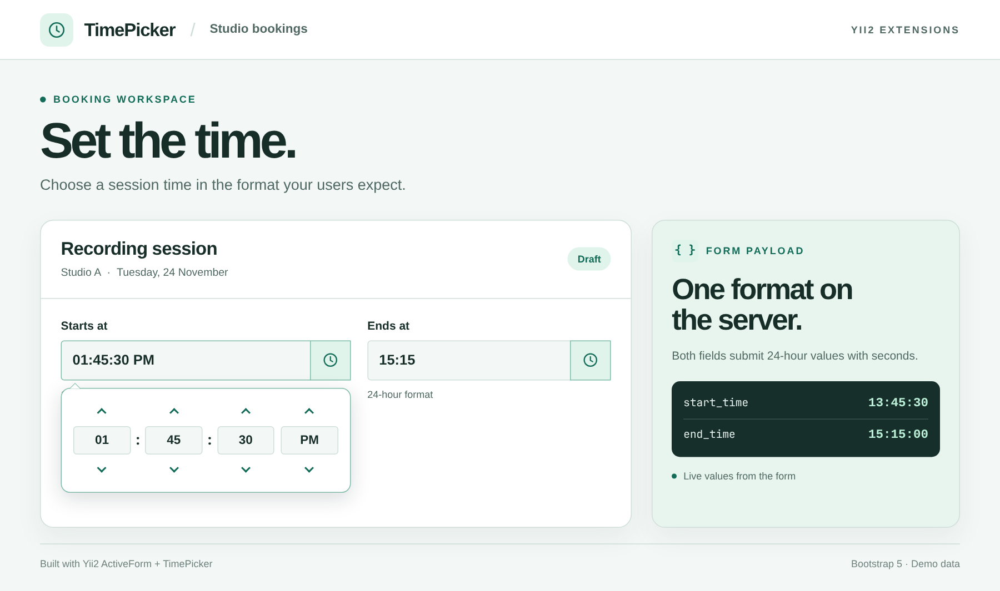
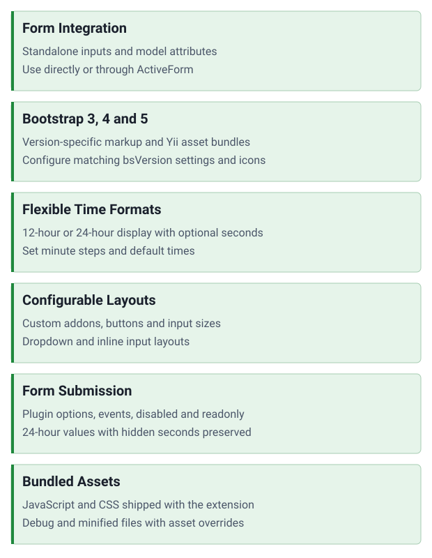

<!-- markdownlint-disable MD041 -->
<p align="center">
    <picture>
        <source media="(prefers-color-scheme: dark)" srcset="https://www.yiiframework.com/image/design/logo/yii3_full_for_dark.svg">
        <source media="(prefers-color-scheme: light)" srcset="https://www.yiiframework.com/image/design/logo/yii3_full_for_light.svg">
        
    </picture>
    <h1 align="center">TimePicker</h1>
    <br>
</p>
<!-- markdownlint-enable MD041 -->

<p align="center">
    <a href="https://github.com/yii2-extensions/time-picker/actions/workflows/build.yml" target="_blank">
        
    </a>
    <a href="https://codecov.io/github/yii2-extensions/time-picker" target="_blank">
        
    </a>
</p>

<p align="center">
    <strong>Bootstrap time picker for Yii2 forms</strong><br>
    <em>Standalone and model-bound inputs, configurable display formats, and canonical form submission</em>
</p>

Select a time with the mouse or keyboard arrow keys. This extension grew out of Kartik Visweswaran's Krajee widget,
which wrapped [rendom's TimePicker plugin](https://github.com/rendom/bootstrap-3-timepicker), forked from
[jdewit's TimePicker](https://github.com/jdewit/bootstrap-timepicker).

<picture>
    <source media="(prefers-color-scheme: dark)" srcset="images/time-picker-dark.png">
    <source media="(prefers-color-scheme: light)" srcset="images/time-picker-light.png">
    
</picture>

## Features

<picture>
    <source media="(min-width: 768px)" srcset="https://raw.githubusercontent.com/yii2-extensions/time-picker/master/docs/svgs/features.svg">
    
</picture>

## Quick start

### Installation

Install with [Composer](https://getcomposer.org/download/):

```bash
composer require yii2-extensions/time-picker
```

Load the Bootstrap CSS that matches your application's `bsVersion`. On Yii 2.0.55, you can use an installed Yii
Bootstrap asset adapter; on Yii 22, provide the Bootstrap CSS and npm jQuery assets in the application. See the
[installation guide](https://github.com/yii2-extensions/time-picker/blob/master/docs/installation.md) and
[upgrade notes](UPGRADE.md).

### Basic usage

Render a standalone input:

```php
use yii\helpers\Html;
use yii2\extensions\timepicker\TimePicker;

echo Html::label('Start time', 'start-time');
echo TimePicker::widget(
    [
        'name' => 'start_time',
        'value' => '11:24 AM',
        'options' => ['id' => 'start-time'],
        'pluginOptions' => [
            'showSeconds' => true,
        ],
    ],
);
```

Or bind the widget to a model attribute inside an existing ActiveForm:

```php
use yii2\extensions\timepicker\TimePicker;

echo $form
    ->field($model, 'start_time')
    ->widget(
        TimePicker::class, [
            'pluginOptions' => [
                'showMeridian' => false,
                'defaultTime' => false,
            ],
        ]
    );
```

## Documentation

Practical guides and usage examples for time inputs, Bootstrap integration and canonical form submission.

- [Installation guide](https://github.com/yii2-extensions/time-picker/blob/master/docs/installation.md): Composer,
  Bootstrap assets, icons and compatibility.
- [Configuration guide](https://github.com/yii2-extensions/time-picker/blob/master/docs/configuration.md): widget
  options, addons, events and asset overrides.
- [Usage examples](https://github.com/yii2-extensions/time-picker/blob/master/docs/examples.md): standalone inputs and
  model-bound forms.
- [Testing guide](https://github.com/yii2-extensions/time-picker/blob/master/docs/testing.md): PHPUnit, quality checks
  and verification limits.
- [Upgrade notes](UPGRADE.md): requirements and migration steps.
- [Changelog](CHANGELOG.md): current work and historical release changes.

## AI assistance

AI agents: read the [documentation index](https://yii2-framework.github.io/docs/llms.txt) and fetch the Markdown version
of a page by appending `index.md` to its URL. The
[AI agents guide](https://yii2-framework.github.io/docs/project/ai-agents/) covers skill installation, client setup and
verification.

- 🤖 [`yii2-time-picker` skill](https://github.com/yii2-extensions/time-picker/blob/master/docs/agents.md): configure
  Bootstrap markup, icons, and plugin options; verify submitted time values and form behavior.

See the [repository guides](#documentation), the [skill source](skills/yii2-time-picker/SKILL.md), the source PHPDoc,
and the [changelog](CHANGELOG.md). Check the guides against the installed revision before applying examples.

## Package information

[](https://www.php.net/releases/8.3/en.php)
[](https://github.com/yiisoft/yii2/releases/tag/2.0.55)
[](https://github.com/yiisoft/yii2/tree/22.0)
[](https://github.com/yii2-extensions/time-picker/blob/master/docs/installation.md)
[](https://packagist.org/packages/yii2-extensions/time-picker)
[](https://packagist.org/packages/yii2-extensions/time-picker)

## Project status

[](https://github.com/yii2-extensions/time-picker/actions/workflows/static.yml)
[](https://github.com/yii2-extensions/time-picker/actions/workflows/quality.yml)

## Security

[](https://scorecard.dev/viewer/?uri=github.com/yii2-extensions/time-picker)
[](https://github.com/yii2-extensions/time-picker/actions/workflows/security.yml)

## Built with AI

[](https://claude.com/claude-code)
[](https://openai.com/codex)
[](https://www.coderabbit.ai)

## Special thanks

Originally developed by Kartik Visweswaran as [Krajee TimePicker](https://github.com/kartik-v/yii2-widget-timepicker).
Stefano Mtangoo adapted the extension for Yii2 Extensions. The upstream copyright and BSD-3-Clause terms remain in
[LICENSE.md](LICENSE.md).

## Our social networks

[](https://x.com/Terabytesoftw)
[](https://www.facebook.com/wilmer.arambula.9)
[](https://www.reddit.com/r/Yii2/)
[](https://t.me/yii_framework_in_english)

## License

[](LICENSE.md)

The bundled Bootstrap Timepicker JavaScript and CSS also carry Joris de Wit's [MIT notice](src/assets/LICENSE).
