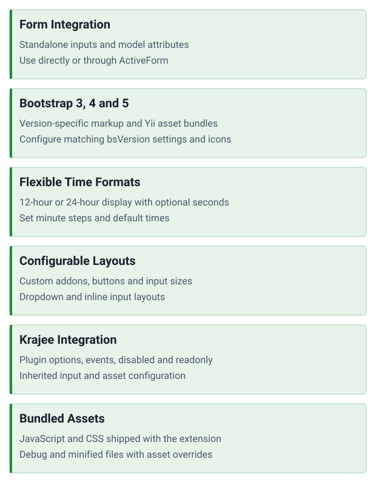

<!-- markdownlint-disable MD041 -->
<p align="center">
    <picture>
        <source media="(prefers-color-scheme: dark)" srcset="https://www.yiiframework.com/image/design/logo/yii3_full_for_dark.svg">
        <source media="(prefers-color-scheme: light)" srcset="https://www.yiiframework.com/image/design/logo/yii3_full_for_light.svg">
        
    </picture>
    <h1 align="center">TimePicker</h1>
    <br>
</p>
<!-- markdownlint-enable MD041 -->

<p align="center">
    <a href="https://github.com/yii2-extensions/time-picker/actions/workflows/build.yml" target="_blank">
        
    </a>
    <a href="https://github.com/yii2-extensions/time-picker/actions/workflows/security.yml" target="_blank">
        
    </a>
</p>

<p align="center">
    <strong>Bootstrap time picker for Yii2 forms</strong><br>
    <em>Standalone and model-bound inputs, configurable time formats, and Krajee asset integration</em>
</p>

Select a time with the mouse or keyboard arrow keys. This extension retains Kartik Visweswaran's Krajee widget, wrapping
[rendom's TimePicker plugin](https://github.com/rendom/bootstrap-3-timepicker), forked from
[jdewit's TimePicker](https://github.com/jdewit/bootstrap-timepicker).

## Features

<picture>
    <source media="(min-width: 768px)" srcset="./docs/svgs/features.svg">
    
</picture>

## Quick start

### Installation

Install with [Composer](https://getcomposer.org/download/) and the Bootstrap integration matching your application. For
Bootstrap 3:

```bash
composer require yii2-extensions/time-picker yiisoft/yii2-bootstrap
```

The application must provide Yii and resolve its Bower assets. See the [installation guide](docs/installation.md) for
asset repository configuration, Bootstrap 4/5, matching `bsVersion` settings and icons. Bootstrap 4/5 requires separate
Font Awesome assets or custom icons; TimePicker does not install Font Awesome.

Applications using Krajee Base 2.x must upgrade to 3.x. See the [upgrade notes](UPGRADE.md) and
[Composer metadata](composer.json). The development baseline is Yii 2.0; Yii 22 compatibility is not established.

### Basic usage

Render a standalone input:

```php
use yii\helpers\Html;
use Yii2\Extensions\TimePicker\TimePicker;

echo Html::label('Start time', 'start-time');
echo TimePicker::widget(
    [
        'name' => 'start_time',
        'value' => '11:24 AM',
        'options' => ['id' => 'start-time'],
        'pluginOptions' => [
            'showSeconds' => true,
        ],
    ],
);
```

Or bind the widget to a model attribute inside an existing ActiveForm:

```php
use Yii2\Extensions\TimePicker\TimePicker;

echo $form
    ->field($model, 'start_time')
    ->widget(
        TimePicker::class, [
            'pluginOptions' => [
                'showMeridian' => false,
                'defaultTime' => null,
            ],
        ]
    );
```

## Documentation

Practical guides and usage examples for time inputs, Bootstrap integration and Krajee configuration.

- [Installation guide](docs/installation.md): Composer, Bootstrap assets, icons and compatibility.
- [Configuration guide](docs/configuration.md): widget options, addons, events and asset overrides.
- [Usage examples](docs/examples.md): standalone inputs and model-bound forms.
- [Testing guide](docs/testing.md): PHPUnit, quality checks and verification limits.
- [Upgrade notes](UPGRADE.md): requirements and migration steps.
- [Changelog](CHANGELOG.md): current work and historical release changes.

## AI assistance

AI agents: start with the [repository guides](#documentation), the source PHPDoc in `src/` and the
[changelog](CHANGELOG.md). Verify inherited APIs against the installed Krajee version before suggesting configuration
changes. Keep the `Yii2\Extensions\TimePicker` namespace and the documented compatibility requirements.

## Package information

[](.github/workflows/build.yml)
[](https://github.com/yiisoft/yii2)
[](https://github.com/kartik-v/yii2-krajee-base)
[](docs/installation.md)
[](https://packagist.org/packages/yii2-extensions/time-picker)
[](https://packagist.org/packages/yii2-extensions/time-picker)

## Project status

[](https://codecov.io/github/yii2-extensions/time-picker)
[](https://github.com/yii2-extensions/time-picker/actions/workflows/quality.yml)

## Special thanks

Originally developed by Kartik Visweswaran as [Krajee TimePicker](https://github.com/kartik-v/yii2-widget-timepicker).
Stefano Mtangoo adapted the extension for Yii2 Extensions. The upstream copyright and BSD-3-Clause terms remain in
[LICENSE.md](LICENSE.md).

## Our social networks

[](https://x.com/Terabytesoftw)
[](https://www.facebook.com/wilmer.arambula.9)
[](https://www.reddit.com/r/Yii2/)
[](https://t.me/yii_framework_in_english)

## License

[](LICENSE.md)
